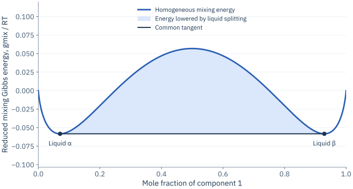

# Phase equilibria and SLLE

A phase-equilibrium calculation combines three requirements: equality of
chemical potentials between coexisting phases, conservation of each component,
and stability against an alternative assemblage with lower Gibbs energy.
Satisfying only the first requirement can produce a metastable candidate.

## Equilibrium as a constrained minimum

At specified T/P, an admissible set of phases minimizes

$$G_{\mathrm{total}}=\sum_{\beta}n^{\beta}
 g^{\beta}(T,P,\mathbf x^{\beta}),$$

subject to

$$\sum_{\beta}n^{\beta}x_i^{\beta}=n_i^{\mathrm{feed}},
\qquad n^{\beta}\ge0,\quad x_i^{\beta}\ge0,\quad
\sum_i x_i^{\beta}=1.$$

For a component that can transfer between two phases, stationarity gives
$\mu_i^{\alpha}=\mu_i^{\beta}$. The model for each phase must include a
consistent reference. A pure-solid candidate has fixed composition and its
own Gibbs energy; it cannot be supplied by a liquid activity coefficient alone.

For phase p, the mole fraction is $\beta_p=n^p/n^{\mathrm{feed}}$.
For nonreactive mixtures it satisfies the molar lever rule
$\mathbf z=\sum_p\beta_p\mathbf x^p$.
Phase mass fractions instead include mean molar masses:

$$w_p=\frac{\beta_p\overline M^p}{\sum_q\beta_q\overline M^q}.$$

The two fraction conventions must not be interchanged in a material balance.

## Vapour–liquid equilibrium

Fugacity equality is the general condition, $f_i^L=f_i^V$.
An EoS can supply both phases through
$x_i\phi_i^LP=y_i\phi_i^VP$. The activity-based convenience routines use the
modified Raoult law

$$y_iP=x_i\gamma_i P_i^{\mathrm{sat}},$$

with ideal vapour, no Poynting correction and supplied pure saturation
pressures. At fixed liquid composition and temperature,

$$P_{\mathrm{bubble}}=\sum_i x_i\gamma_iP_i^{\mathrm{sat}},\qquad
y_i=\frac{x_i\gamma_iP_i^{\mathrm{sat}}}{P_{\mathrm{bubble}}}.$$

The activity model supplies gamma; it does not generate the saturation-pressure
correlation. Its validity interval and units must be checked separately.
See the [VLE recipe](../guide/calculations.md#compute-a-bubble-pressure) and
[notebook 05](../notebooks/05_vapour_liquid_equilibrium.ipynb).

## Liquid–liquid equilibrium and stability

For two liquids using the same pure-liquid standard states, coexistence
requires equal activities:

$$\ln(x_i^{\alpha}\gamma_i^{\alpha})=
\ln(x_i^{\beta}\gamma_i^{\beta}).$$

For a binary, a common tangent to the Gibbs mixing curve identifies equal
chemical potentials in the two phases. The stable mixture follows the lower
convex envelope of that curve. A homogeneous state above a supporting tangent
can lower its energy by splitting.

<figure class="tw-figure" markdown="1">

<figcaption>Analytic illustration: the symmetric Margules model with χ=3. The horizontal common tangent connects the two coexisting compositions. The shaded gap is the free-energy reduction available by splitting an intermediate feed.</figcaption>
</figure>

A local curvature test identifies spinodal instability, but a locally convex
state can still be globally metastable. A more general test is the reduced
tangent-plane distance relative to a reference liquid z:

$$\mathrm{TPD}(\mathbf w;\mathbf z)=\sum_i w_i
\left[\ln(w_i\gamma_i(\mathbf w))-\ln(z_i\gamma_i(\mathbf z))\right].$$

A negative TPD at any admissible trial composition w establishes instability
of z. Finding no negative value in a finite numerical search provides evidence
at its configured resolution and tolerances. Boundary feeds also require
respecting which components are actually available.

## Solid–liquid equilibrium

For a pure solid s, neglecting the heat-capacity difference between solid and
liquid and treating the fusion enthalpy as constant,

$$\frac{\mu_s^{S}-\mu_s^{\mathrm{pure,L}}}{RT}
=-\frac{\Delta h_{\mathrm{fus},s}}{R}
\left(\frac1T-\frac1{T_{m,s}}\right).$$

Equality with the liquid chemical potential gives the Schröder–van Laar relation

$$\ln(x_s\gamma_s)=-\frac{\Delta h_{\mathrm{fus},s}}{R}
\left(\frac1T-\frac1{T_{m,s}}\right).$$

The solid is pure, with no solid-solution or cocrystal mixing energy. Multiple
roots or competing liquids/solids require a coupled stability calculation.
The [solubility recipe](../guide/calculations.md#calculate-solubility-and-slle)
and [notebook 07](../notebooks/07_solubility_and_solid_liquid_flash.ipynb)
make this distinction explicit.

## Binary and ternary SLLE

For C components and Π phases without reactions, the Gibbs phase rule is
$F=C-\Pi+2$. At fixed pressure, a binary S+L₁+L₂ equilibrium has F=0: its
temperature and phase compositions form an invariant. A three-phase binary
assemblage has more phase amounts than independent component balances, so its
amounts need not be uniquely determined. An equally stable two-phase
representation of a feed can occur at the invariant.

For a ternary at fixed T/P, the three coexisting phase compositions are fixed,
while feeds inside their tie triangle change the phase amounts. These amounts
must satisfy all three component balances. A solid corner and two liquid
corners can be close together geometrically; a physically thin triangle should
be magnified for inspection rather than artificially widened.

[Tutorial 10](../notebooks/10_binary_slle_saft.ipynb) calculates a binary
invariant. [Tutorial 11](../notebooks/11_ternary_slle_saft.ipynb) solves a ternary
liquid/solid flash and tie triangle.
[Tutorial 12](../notebooks/12_binary_ternary_slle_cosmors.ipynb) repeats the
workflow with actual COSMO-RS inputs. All use measured benzene fusion data and
explicitly stated solid assumptions.

## What the numerical algorithms establish

CEM approximates the Gibbs surface on a composition grid and constructs a
convex representation, with optional polishing. TPD searches for destabilizing
compositions. ReducedHELD searches admissible liquid/solid assemblages and
reports convergence and configured certification diagnostics. Their guarantees
reflect the model, search strategy, resolution and numerical tolerances.

Inspect balances, chemical-potential equality and solid saturation independently
of solver flags. Compare with experimental data to assess physical accuracy.
For implementation entry points see [API and units](../api.md) and
[capabilities](../capabilities.md).
